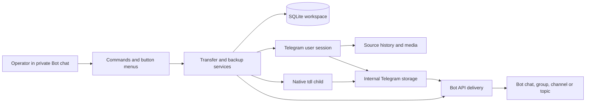

# Architecture and engineering reference

[简体中文](architecture_zh.md) · [Home](../README.md) · [User guide](manual.md) · [Deployment](deployment.md)

## System boundary

The application is a trusted Telegram workspace with several operators and one
shared result store. It is not a tenant-isolation boundary. An operator is the
Telegram user interacting with the Bot; an executor is a signed-in Telegram user
session that reads sources and prepares media. The Bot identity performs final
Bot API delivery. Keeping these identities separate is essential to routing,
permission checks and recovery.



Bot API alone cannot resolve arbitrary historical message URLs into complete
albums. User-session MTProto access supplies history, membership operations and
media references; native tdl handles the default byte-transfer path. Server-side
copies avoid transferring bytes when possible. Local media files are temporary,
while internal storage holds reusable Telegram messages.

## Source map

| Package | Owns |
| --- | --- |
| `core` | Settings, URL normalization, errors, localization and local-time rendering |
| `bot` | Command registry, middleware, menus, progress and frontend presentation |
| `transfers` | Routing, authorization policy, job lifetimes, deduplication and activity |
| `transfers/backups` | Dump/follow scheduling, checkpoints, pacing and recovery |
| `storage` | SQLite schema, result and delivery ledgers, membership and persisted UI state |
| `integrations/telegram` | MTProto history/media, shared-session client and Bot API delivery |
| `integrations/tdl` | Native process execution, session import, album receipts and binary updates |
| `runtime` | CLI, setup, login, supervision, local RPC and platform-specific lifecycle |
| `locales`, `resources` | Translation catalogs and the packaged configuration template |

Start reading at [`BotApplication`](../src/tdl_bot/bot/application.py),
[`TransferService`](../src/tdl_bot/transfers/service.py) and
[`BackupService`](../src/tdl_bot/transfers/backups/service.py).
The package-level `main()` is the process entry point; CLI implementation lives
in `runtime/cli.py`.

## Job acceptance and identity snapshots

A job binds the operator, executor key, destination/owner scope, storage target,
source URL, originating Bot message and progress message. The snapshot is the
contract for retries: later account or target changes do not alter accepted work.

Acceptance checks current membership, destination-management rights and executor
access before adding to a bounded FIFO queue. The accepted-request ledger keys
Bot submissions by operator and originating message ID, so repeated delivery of
the same Telegram update retrieves the accepted job rather than adding another.
An unfinished job with the same normalized source, destination and executor is
also rejected. These checks solve different problems: update redelivery versus
an operator submitting a second message.

The worker waits until the initial progress response is ready, then owns the job's
operation and cleanup. `JobQueue.discard()` can remove a queued job immediately
without consuming a worker or leaving its queue capacity occupied.
See [`jobs.py`](../src/tdl_bot/transfers/jobs.py) for serialized fields and queue ownership.

## Preparation, result reuse and delivery

`TransferService._transfer()` takes a per-URL work lock and a binary-update lease.
It checks saved results first. Otherwise it resolves the source, expands its album,
adds source aliases and computes a media fingerprint. A second lock on the group
identity prevents different links into the same content from preparing it twice.
The lock entries are reference-counted and released when unused.

The fingerprint hashes ordered Telegram media type/ID, captions and entities,
excluding spoiler entities that the application intentionally removes. It is
**not a hash of downloaded file bytes**: separately uploaded, byte-identical files
with different Telegram identities need not match. Changed captions or formatting
produce a different identity. Text-only groups have no media fingerprint.

Preparation follows this order:

1. Reuse a complete, available internal result associated with the URL or group
2. Try a server-side copy that omits the forwarding attribution
3. Copy text directly when there are no media bytes
4. Use native `tdl forward --mode clone` for eligible media
5. Use download/verify/upload for basic groups or the standalone Telethon path

For local downloads, completeness requires one nonempty, nonsymlink file per source
message and exact document sizes. Photos are not checked against an exact document
size because Telegram exposes several resolutions.

`_complete()` records the storage result and its aliases **before** Bot delivery.
It removes spoilers from stored messages, then writes a delivery attempt in state
`sending` before calling the Bot API. Delivery completion/failure and known message
IDs are recorded separately. A failed final delivery therefore does not discard a
successful storage preparation. Missing stored media is marked unavailable so a
later request can prepare it again.

The ledger deliberately distinguishes a reusable result from delivery to a
particular destination. Reusing preparation does not suppress an intentional new
send to a destination. See [`media.py`](../src/tdl_bot/transfers/media.py),
[`store.py`](../src/tdl_bot/storage/store.py) and
[`delivery.py`](../src/tdl_bot/integrations/telegram/delivery.py).

### Native clone receipts and album assembly

A native CLI exit code alone is insufficient proof of a complete album. The clone
adapter attaches a random per-job receipt and source position through an edit
expression and uses `--single` for the already-resolved source members. It searches
for those exact receipts, verifies completeness and document sizes, and refuses
missing or ambiguous mappings. Neither newest-message order nor upload order
identifies a source file.

Telethon then assembles the final album from Telegram media references in source
order, preserving original attributes, previews, captions and entities without
uploading those bytes again. Receipt staging posts are cleaned on success,
failure and cancellation. A hard engine crash can leave remote staging posts;
local cleanup is not a transaction over Telegram.
See [`albums.py`](../src/tdl_bot/integrations/tdl/albums.py).

## Authorization and session ownership

`AccessPolicy` reads indexed membership state from SQLite. Roles, ban expiry and
ownership are checked at command/callback boundaries and again by services.
Checks after awaited operations prevent a stale screen or a slow network request
from retaining rights revoked meanwhile. A reconciliation loop cancels disallowed
foreground work and pauses affected backups.

The executor catalog is built from valid tdl namespaces in `TDL_DIR`. Session
backup is read from a private temporary directory into an in-memory Telethon
session; the backup is then removed. The default tdl path does not create another
persistent Telethon session or ask for separate application API credentials.
Telegram verifies each identity. Duplicate authorization keys are not connected
twice; duplicate UIDs prefer the shared namespace, then deterministic namespace order.

An operator automatically uses an executor with their verified UID, otherwise the
shared executor. Administrators may override their own new-task selection. A
regular operator cannot borrow another member's private executor merely because
they can manage a shared task. Retries retain their executor and fail explicitly
if that identity is unavailable.

Namespace discovery is separate from membership: logging in does not authorize
someone to operate the Bot. `ADMIN_USER_IDS` seeds only an uninitialized workspace;
SQLite is authoritative thereafter. Last-administrator checks preserve a usable
management path. [`accounts.py`](../src/tdl_bot/transfers/accounts.py) contains these boundaries.

## Concurrency, coordination and backpressure

`WORKERS` limits foreground worker lifetimes and independently sets the backup
cycle pool size. Their combined active count can exceed `WORKERS`. The foreground
waiting queue is separately bounded by `QUEUE_SIZE`. Independent jobs can resolve,
prepare and deliver concurrently; no whole-job account mutex covers all stages.

That does **not** imply unrestricted parallel MTProto access. Native tdl owns its
namespace storage and account protocol coordination while its child runs. Shared
Telethon RPCs wait for that authorization. Bolt namespaces can operate independently;
legacy shared databases require broader storage coordination. Removing these
locks would allow competing protocol layers to use the same authorization.

The current native clone downloads a file before uploading it; transfer threads
parallelize chunks within a direction. Bot worker count, per-file threads and
connection capacity are different controls. The Bot does not currently promise
same-file full duplex, bandwidth saturation or a fixed Telegram account ceiling.

`UpdateGate` gives a waiting binary update priority over new transfer leases.
Existing jobs finish before replacement; new jobs cannot continuously starve the
updater. All execution accounts share this gate. The updater compares versions,
verifies checksums and executable version, and atomically installs a verified
binary; failure keeps the old binary.

## Durable history backups

`history.read_page()` reads bounded chronological pages and extends a page to its
album boundary. A dump captures its upper message ID once; a follow captures its
initial cursor and polls later messages. Both process text and media through the
same storage/delivery pipeline without emitting a progress reply per source item.
Follow creation checks routing cycles to avoid self-feeding backup paths.

Before remote writes, the backup stores the current unit and a `writing` phase.
Its cursor advances only after the entire unit is prepared and delivered. On
restart, an interrupted writing phase becomes `uncertain` and pauses. Explicit
retry/skip is necessary because Telegram and SQLite cannot share a commit.
Safe read failures back off automatically; uncertain writes do not.

`BackupPacer.reserve()` atomically reserves **admission** spacing in the event loop:
one second per message/account and three seconds per message/destination chat.
Every album member counts; topics share the parent chat's budget. No write lease
is held over the byte transfer, so differently sized jobs can finish together.
This is not a guarantee of spacing between completion timestamps. FloodWait
extends the account deadline; Bot API retry delays extend the shared Bot deadline.
Waits remain cancellable and honor engine quiescence.

Follow quotas count active and paused tasks, are persisted per member, and are
checked on create/resume. Cancellation releases quota immediately; seven-day list
retention does not delete checkpoint or accepted-request identities.
See [`backups`](../src/tdl_bot/transfers/backups/service.py),
[`pacing.py`](../src/tdl_bot/transfers/backups/pacing.py) and
[`storage/backups.py`](../src/tdl_bot/storage/backups.py).

## Lifecycle and failure semantics

### Unix and Linux containers

A supervisor owns polling frontend generations; a detached engine owns transfer
clients, subprocesses, queues and cancellation. They communicate through an
owner-only Unix socket. Durable snapshots preserve progress-message IDs, task
identity, destination and accepted-request deduplication across frontend restarts.

Manual reload immediately replaces the frontend and requests engine handoff.
Source/catalog digests identify the generation; there is no file watcher. Backups
quiesce at unit boundaries. The engine changes generation only after active jobs,
backup units and RPCs drain. A frontend health task ensures replacement after
handoff. Continuous accepted work can delay engine replacement.

Full stop disables polling and frontend health restart before draining the engine.
An engine verifies the launching supervisor identity after acquiring its instance
lease, preventing late starts after shutdown. The container entrypoint waits for
engine shutdown before exit; Docker's stop deadline is still authoritative.

### Native Windows

Polling and services share one event loop/process. Windows uses a nonblocking
one-byte `msvcrt` lease instead of Unix `flock`; file contents alone do not prove
ownership. A stop-request file drives cooperative drain and a heartbeat supports
local health checks. Accepted handlers and permission cleanup finish before shared
clients close. Noninteractive child process groups keep console Ctrl+C from
bypassing the parent's drain; explicit cancellation terminates/reaps the child.
There is no Unix RPC, hot reload or automatic frontend crash restart.

### Cancellation and crash recovery

A job owns its child process and `data/jobs/job-*` directory. Cancellation first
terminates and reaps the child, then removes its temporary files; TMPDIR/TMP/TEMP
point native temporary work into that directory. Other jobs' directories are not
removed. Managed leftover job directories are cleaned at engine startup.

Crash recovery can resume work that had not begun remote writes. Upload/delivery
flags preserve uncertainty once a write may have happened. Exactly-once Telegram
delivery is not guaranteed: a successful send with a lost acknowledgement is
indistinguishable from some failures. The system surfaces that decision instead
of silently replaying potentially completed writes.

## Persistence, configuration and trust

Schema version 9 covers workspace members/preferences/targets, retry records and
archive, runtime jobs, accepted requests, stored results and source aliases,
delivery attempts, backups, activity and management events. Ordered migrations
make private pre-upgrade database backups and reject unsupported newer schemas.
Frontends do not migrate a database still owned by an old engine generation.

Only accepted link jobs and explicit join actions create activity events and compact
storage posts. Backup units and other commands do not. An activity post is
acknowledged before the related operation; an unacknowledged post is not blindly
recreated. Activity references existing stored media instead of duplicating it.
Admin history has separate activity/management tabs with UID-based filters and
20-row pages. Usernames are presentation; immutable UIDs retain identity.

Configuration merges an explicitly selected dotenv file with process environment
overrides, without exporting file values. Paths resolve against the file location.
Children inherit its absolute filename and reread values on reload. Runtime socket
paths can be separate from persistent data. Resource leases remain with database,
executable and session resources even when runtime files use container tmpfs.

Session keys and Bot tokens are credentials. This shared workspace's administrator
and executor access are trust boundaries, not a sandbox for untrusted tenants.
Use one network exit per shared authorization and protect persistent files with
OS permissions. Timestamps store UTC and render in the running system's local
zone, including the recorded instant's daylight saving time; containers use `TZ`.

## UI and localization contracts

Commands, routing and Telegram hints share [`COMMANDS`](../src/tdl_bot/bot/commands.py).
Menus invoke those same operations, with a per-operator lock and persisted menu
revision. A callback is bound to its owner, message and revision. Revisions are
consumed before mutation, and confirmations have one-use tokens; old/double clicks
cannot replay the prior menu action. This UI protection does not replace service authorization.

English source templates are localization keys. `en.json` contains language metadata
and an empty message map; `zh.json` translates the templates. Catalog loading
checks duplicate keys and placeholder compatibility. Missing translations fall
back to English. Persisted template aliases keep saved stages/errors readable
when wording changes. Render errors with the viewer's current language, not the
worker's original language; retain media text unchanged.

## Verification and releases

```sh
uv sync --locked
uv run ruff format --check src tests
uv run ruff check src tests
uv run ty check --error-on-warning
uv run pytest -q
uv build --no-sources
```

The offline suite uses real service/SQLite/dispatcher flows with external Telegram
and native-transfer boundaries replaced. It checks permission races, persistence,
recovery, cancellation, receipts, delivery and platform lifecycle. Coverage includes
branches and requires 85% on the full measured suite. Annotations are optional;
Ruff does not enforce ANN. Ty keeps normal application checks, with a targeted
test override for duck-typed arguments rather than globally disabling type checks.

`checks.yaml` defines Linux/macOS/Windows validation and wheel-tool installation
outside the checkout. Windows excludes Unix-only lifecycle/process suites and
runs without the coverage gate; Unix runs the measured suite. Real Telegram
behavior requires separate acceptance checks; green offline CI is not a live
network or throughput test.

`container.yaml` publishes only on a pushed stable `vX.Y.Z` tag matching package
metadata. It reuses checks, smoke-checks the container, publishes Linux amd64/arm64
images, then attaches wheel/source distributions to the GitHub Release. It does
not create tags or publish to PyPI. Ordinary pushes/PRs run checks only. These are
workflow contracts; inspect Actions for evidence about any particular revision.
