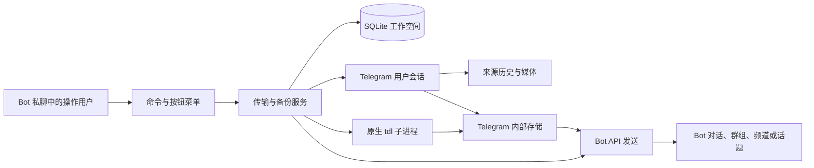

# 技术架构与工程参考

[English](architecture.md) · [首页](../README_zh.md) · [用户手册](manual_zh.md) · [部署指南](deployment_zh.md)

## 系统边界

应用是由多个操作用户和一个共用结果存储组成的可信 Telegram 工作空间，不提供租户隔离
操作用户是与 Bot 交互的 Telegram 用户，执行账号是读取来源并准备媒体的已登录 Telegram 用户会话，Bot 身份通过 Bot API 完成最终发送
区分这些身份，是路由、权限检查和恢复的基础



仅靠 Bot API 无法从任意历史消息 URL 解析出完整媒体组
用户会话通过 MTProto 提供历史、成员操作和媒体引用，原生 tdl 承担默认的文件传输
可以服务端复制时不传输文件字节
本地媒体只是临时文件，内部存储中的 Telegram 消息才是可再次使用的结果

## 源码职责

| 包 | 职责 |
| --- | --- |
| `core` | 配置、URL 规范化、错误、本地化和本地时间显示 |
| `bot` | 命令注册、中间件、菜单、进度与前端展示 |
| `transfers` | 路由、权限策略、任务生命周期、去重和活动记录 |
| `transfers/backups` | dump/follow 调度、检查点、限速和恢复 |
| `storage` | SQLite 结构、结果和发送台账、成员及持久化界面状态 |
| `integrations/telegram` | MTProto 历史/媒体、共享会话客户端与 Bot API 发送 |
| `integrations/tdl` | 原生进程、会话导入、媒体组回执与二进制更新 |
| `runtime` | CLI、配置、登录、进程管理、本地 RPC 与平台生命周期 |
| `locales`、`resources` | 翻译目录与打包配置模板 |

可以从 [`BotApplication`](../src/tdl_bot/bot/application.py)、[`TransferService`](../src/tdl_bot/transfers/service.py) 和 [`BackupService`](../src/tdl_bot/transfers/backups/service.py) 开始阅读
包级 `main()` 是进程入口，CLI 实现在 `runtime/cli.py`

## 任务接收与身份快照

任务绑定操作用户、执行账号键、目标及管理归属、内部存储、来源 URL、原始 Bot 消息和进度消息
快照构成重试的执行约定，后续修改账号或目标不会改变已接收任务

接收任务时先检查当前成员权限、目标管理权限和执行账号使用权，再加入有界 FIFO 队列
请求接收台账以操作用户和原始消息 ID 为键，重复投递同一 Telegram 更新时返回原任务，不再创建任务
相同规范化来源、目标及执行账号的未结束任务也会被拒绝
两者分别解决更新重复投递，以及用户再次发送消息造成的重复提交

worker 等待初始进度回复准备就绪，再接管执行与清理
`JobQueue.discard()` 能立刻移除排队任务，无需等待 worker，也不会继续占用队列容量
序列化字段与队列归属见 [`jobs.py`](../src/tdl_bot/transfers/jobs.py)

## 准备、结果复用与发送

`TransferService._transfer()` 获取 URL 级工作锁和二进制更新使用租约，先检查已有结果
未命中时解析来源、展开媒体组、补充来源别名并计算媒体指纹
第二层媒体组身份锁，防止指向同一内容的不同链接重复准备
锁条目通过引用计数管理，无使用者后释放

指纹按顺序编码 Telegram 媒体类型/ID、文字与 entities，排除应用本就会移除的 spoiler entity，再计算哈希
它**不是下载文件字节的哈希**，分别上传但字节一致的文件，Telegram 身份不同就不一定命中
文字或格式变化会产生不同身份，纯文字组没有媒体指纹

准备顺序为：

1. 使用 URL 或媒体组关联的完整、可用内部结果
2. 尝试省略转发署名的服务端复制
3. 没有媒体文件时直接复制文字
4. 对符合条件的媒体使用原生 `tdl forward --mode clone`
5. 基础群或独立 Telethon 路径使用下载、校验、上传

本地下载要求每条来源消息恰好对应一个非空、非符号链接文件，document 文件大小必须完全一致
图片有多种分辨率，不套用 document 的精确大小校验

`_complete()` 在 Bot 发送**之前**记录内部结果与来源别名
先移除内部消息的隐藏效果，再记录 `sending` 状态的发送尝试，然后调用 Bot API
完成或失败状态及已知消息 ID 单独记录
因此最终发送失败，不会丢弃已经准备成功的内部结果
已删除的内部媒体被标记不可用，后续请求可以重新准备

台账区分可重复使用的准备结果，以及向某个目标的发送行为
避免重复准备，不等于抑制用户主动发起的再次发送
相关实现见 [`media.py`](../src/tdl_bot/transfers/media.py)、[`store.py`](../src/tdl_bot/storage/store.py) 和 [`delivery.py`](../src/tdl_bot/integrations/telegram/delivery.py)

### 原生 clone 回执与媒体组装配

原生 CLI 的退出码不足以证明整个媒体组完整
clone 适配器通过编辑表达式附加每任务随机回执与来源位置，对已经解析好的成员使用 `--single`
随后精确查找回执，校验完整性和 document 大小，拒绝缺失或歧义映射
不把最新消息顺序或上传顺序当作文件身份

Telethon 使用 Telegram 媒体引用按来源顺序组成最终媒体组，保留原始属性、预览、文字和 entities，不再次上传文件字节
成功、失败和取消都清理带回执的临时消息
引擎硬崩溃可能遗留远端临时消息，本地清理不是覆盖 Telegram 的事务
见 [`albums.py`](../src/tdl_bot/integrations/tdl/albums.py)

## 权限与会话归属

`AccessPolicy` 从 SQLite 按索引读取成员状态
命令和回调入口检查角色、封禁期限及归属，服务层再次检查
等待网络操作后重新检查，防止旧界面或慢请求继续使用期间已被撤销的权限
协调循环取消失去权限的前台任务，并暂停受影响的备份

执行账号目录来自 `TDL_DIR` 中有效的 tdl 命名空间
会话备份经私有临时目录读取，导入内存 Telethon 会话后删除备份
默认 tdl 路径不额外生成持久化 Telethon 会话，也不要求单独填写应用 API 凭据
各身份通过 Telegram 验证，同一授权密钥不会重复连接
重复 UID 优先公共命名空间，其次按命名空间顺序确定

操作用户优先使用经验证 UID 与自己匹配的执行账号，否则使用公共执行账号
管理员可以覆盖自己的新任务选择
普通用户即使有权管理共用任务，也不能因此使用其他成员的私有执行账号
重试保留执行身份，身份不可用时明确失败

发现会话与成员授权是两回事，登录不会自动获得 Bot 操作权限
`ADMIN_USER_IDS` 只初始化空工作空间，之后 SQLite 为权限来源
最后管理员保护确保仍有管理入口
相关边界位于 [`accounts.py`](../src/tdl_bot/transfers/accounts.py)

## 并发、协调与背压

`WORKERS` 限制前台 worker 生命周期数量，同时独立设置备份循环池大小，两者活跃总数可以超过 `WORKERS`
前台等待队列由 `QUEUE_SIZE` 单独限制
无关任务可以同时解析、准备和发送，不使用覆盖整个任务的账号互斥锁

这**不代表** MTProto 可以无限并行访问
原生 tdl 子进程运行期间持有命名空间存储和账号协议协调权，共享该授权的 Telethon RPC 需等待
Bolt 命名空间可以独立运行，legacy 共用数据库需要更大范围的存储协调
删除这些锁，会让不同协议层争用同一授权

当前原生 clone 先完成单文件下载，再上传，传输线程并行处理同一方向的分片
Bot worker 数、每文件线程数和连接容量是不同参数
当前 Bot 不承诺同文件全双工、占满带宽或固定的 Telegram 账号并发上限

`UpdateGate` 让等待更新的二进制写入优先于新传输租约
已有任务结束后才能替换，新任务无法持续抢占导致更新饥饿
所有执行账号共用该门闩
更新器比较版本、校验 checksum 和程序版本，验证完成后原子安装，失败保留旧程序

## 持久化历史备份

`history.read_page()` 读取有界的正序历史页，并扩展到媒体组边界
dump 创建时固定上界消息 ID，follow 固定初始游标，后续轮询新消息
两者都通过相同的内部存储与发送流程处理文字和媒体，不为每条来源消息发送进度回复
follow 创建时检查路由环，防止备份内容循环流转

远程写入前先保存当前单元及 `writing` 阶段，整个单元准备并发送完成后才推进游标
重启时，写入中断变为 `uncertain` 并暂停
Telegram 与 SQLite 无法共用提交事务，所以必须显式选择重试或跳过
安全的读取失败自动退避，结果不确定的写入不自动重放

`BackupPacer.reserve()` 在事件循环内原子预留**准入**间隔：每消息/账号一秒，每消息/目标群三秒
媒体组每个成员都计数，话题共用父群预算
文件传输期间不持有全局写入租约，不同大小的任务可以同时结束
这不保证完成时间之间有固定间距
FloodWait 延后账号截止时间，Bot API 重试延迟延后共用 Bot 截止时间
等待可以取消，并响应引擎静默交接

追踪配额按成员持久化，计入活动和暂停任务，在创建/恢复时检查
取消立即释放名额，七天列表保留期不删除检查点及请求身份
见 [`backups`](../src/tdl_bot/transfers/backups/service.py)、[`pacing.py`](../src/tdl_bot/transfers/backups/pacing.py) 与 [`storage/backups.py`](../src/tdl_bot/storage/backups.py)

## 生命周期与失败语义

### Unix 与 Linux 容器

管理器负责 Bot polling 前端的进程代际，独立引擎拥有传输客户端、子进程、队列及取消逻辑
两者通过仅所属用户可访问的 Unix socket 通信
持久化快照使进度消息 ID、任务身份、目标及请求去重状态跨前端重启保留

手动 reload 立即替换前端并请求引擎交接
源码与语言目录摘要标识代际，不使用文件监控
备份在单元边界停止接收后续工作，引擎等待活动任务、备份单元和 RPC 全部结束后切换
前端健康任务确保交接后启动替代引擎，持续接收的任务可能推迟引擎切换

完整停止时，先关闭 polling 和前端健康重启，再等待引擎完成
引擎获取实例租约后验证启动它的管理器身份，避免关闭后延迟启动
容器入口等待引擎结束才退出，但仍受 Docker 停止期限约束

### Windows 原生

polling 和服务共用事件循环与进程
Windows 使用非阻塞单字节 `msvcrt` 租约替代 Unix `flock`，文件内容本身不能证明持有权
停止请求文件触发正常结束，本地 heartbeat 用于健康检查
已接收的处理器和权限清理结束后，才关闭共享客户端
非交互子进程使用独立进程组，防止控制台 Ctrl+C 绕过父进程的正常收尾，显式取消仍会终止并回收子进程
不使用 Unix RPC，不提供热重载或前端崩溃自动重启

### 取消与崩溃恢复

每个任务拥有自己的子进程及 `data/jobs/job-*` 目录
取消先终止并回收子进程，再删除临时文件
TMPDIR/TMP/TEMP 将原生临时工作指向任务目录，不清理其他任务目录
引擎启动时清理遗留的受管任务目录

崩溃恢复可以继续尚未开始远程写入的工作
upload/delivery 标记保留已可能发生写入的不确定性
不保证 Telegram 恰好一次发送：发送成功但回执丢失，与某些失败无法区分
系统显式暴露这个决策，不自动重放可能已经完成的写入

## 持久化、配置与信任

数据库结构版本为 9，覆盖成员/偏好/目标、重试及归档、运行任务、已接收请求、内部结果与来源别名、发送尝试、备份、活动及管理记录
迁移按顺序执行，升级前生成私有数据库备份，拒绝不支持的新版结构
前端不会迁移仍由旧代引擎使用的数据库

只有已接收链接任务和显式加群操作生成活动事件及简洁的内部存储记录，备份单元和其他命令不生成
关联操作开始前需确认记录发送成功，未确认的记录不会盲目重发
活动关联已有媒体，不额外复制
管理员历史通过活动/管理标签切换，以 UID 筛选，每页 20 条
用户名用于展示，身份仍使用不可变 UID

配置合并显式选择的 dotenv 文件和进程环境覆盖值，不将文件值导出到环境
路径基于配置文件位置解析，子进程继承其绝对路径，在 reload 后重新读取
运行时 socket 可独立于持久化目录
即使运行文件放在容器 tmpfs，资源租约仍与数据库、程序和会话资源放在一起

会话密钥与 Bot token 都是凭据
工作空间的管理员和执行账号访问权构成信任边界，不是面向不可信租户的沙箱
共享授权使用统一网络出口，持久化文件使用系统权限保护
时间戳以 UTC 保存，以运行系统本地时区显示，并使用记录时刻对应的夏令时，容器通过 `TZ` 选择时区

## 界面与本地化约定

命令、路由及 Telegram 提示共用 [`COMMANDS`](../src/tdl_bot/bot/commands.py)
菜单调用相同操作，按用户加锁并持久化菜单修订号
回调绑定用户、消息和修订号，修改前消耗修订号，确认操作使用一次性 token
旧按钮或重复点击不能重放原菜单动作，这不替代服务层授权检查

英文源码模板作为翻译键
`en.json` 只含语言信息与空消息表，`zh.json` 提供翻译
加载时校验重复键与占位符兼容性，缺失翻译回退英文
模板措辞变化时通过持久化别名保留旧任务状态/错误的可读性
错误按查看者当前语言渲染，不固定为 worker 最初使用的语言，媒体原文保持不变

## 验证与发布

```sh
uv sync --locked
uv run ruff format --check src tests
uv run ruff check src tests
uv run ty check --error-on-warning
uv run pytest -q
uv build --no-sources
```

离线测试使用真实服务、SQLite 和 dispatcher 流程，替换外部 Telegram 及原生传输边界
检查权限竞争、持久化、恢复、取消、回执、发送及平台生命周期
完整测量的测试集包含分支覆盖，要求达到 85%
类型标注按需使用，Ruff 不启用 ANN，Ty 保留普通应用检查，测试仅定向放宽鸭子类型参数，不全局关闭类型检查

`checks.yaml` 定义 Linux/macOS/Windows 验证，并在仓库外安装 wheel 进行工具检查
Windows 排除 Unix 专属生命周期/进程测试，不执行覆盖率门槛，Unix 运行带覆盖测量的测试集
真实 Telegram 行为需另行验收，离线 CI 通过不代表真实网络或吞吐测试通过

`container.yaml` 只在推送与包版本匹配的稳定 `vX.Y.Z` tag 时发布
流程复用检查、验证容器、发布 Linux amd64/arm64 镜像，再将 wheel/源码包附加到 GitHub Release
流程不创建 tag，不发布到 PyPI，普通提交和 PR 只运行检查
这些是工作流约定，某个修订是否通过请以 Actions 记录为准
